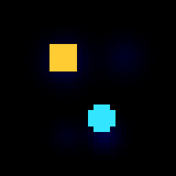

# tiny-jepa

**World Labs for your laptop.** A tiny, hackable, action-conditioned JEPA
(Joint Embedding Predictive Architecture) world model — in pure numpy, zero
required dependencies. The whole thing is ~1,500 lines you can read in an
afternoon. Inspired by Yann LeCun's predictive world-model program and the
spatial-intelligence spirit of Fei-Fei Li's World Labs.



*The shipped checkpoint, hunting pellets with learned vision — no hand-coded
game AI, just a world model that imagines, perceives, and plans.*

## Install

```bash
pip install tiny-jepa
# extras: pip install "tiny-jepa[onnx]"  (ONNX export)
#         pip install "tiny-jepa[gym]"   (Gymnasium wrapper)
```

## 5-line quickstart

```python
from tiny_jepa import TinyJEPA, OrbyWorld
model = TinyJEPA.load("tiny_jepa/checkpoints/orby_v1.npz")  # pretrained
env = OrbyWorld(seed=0)
for _ in range(64):
    env.step(model.plan(env.render(), env.agent))  # see, imagine, act
```

That's it — a world model hunting pellets from raw pixels. Now go crazy:
`model.imagine(z, actions)` rolls out latent futures, `model.dream(frame,
actions)` decodes them to images, `train_on_env` / `train_on_data` train
your own worlds.

Try it with zero installs: [](https://colab.research.google.com/github/OpenSourceRulesz/tiny-jepa/blob/main/examples/quickstart_colab.ipynb)
— or drive it yourself in the [playable web demo](https://github.com/OpenSourceRulesz/tiny-jepa#playable-demo).

## What's inside

| Module | What it does |
|---|---|
| `TinyJEPA` | `encode` / `imagine` / `decode` / `dream` / `perceive_pellet` / `predict_reward` / `plan` / `save` / `load` |
| `train` | `train_on_env` (built-in world), `train_on_data` (your own trajectories) |
| `export_onnx` | Bit-accurate ONNX export for any runtime |
| `envs` | `OrbyWorld` (built-in 2D world) + `GymWrapper` |
| `checkpoints/orby_v1.npz` | Pretrained: ~8.6 pellets/episode vs ~0.2 random |
| `challenges/` | Quests. Start here if you want to make your mark |
| `tiny_jepa/bench` | **tiny-spatial**: 5-probe spatial-intelligence benchmark (SPEC.md) |

## tiny-spatial — does your world model understand space?

```python
from tiny_jepa.bench import run_benchmark
run_benchmark("tiny_jepa/checkpoints/orby_v1.npz").print()
```

Five probes — object permanence under occlusion, hallucination (does it
collapse to the dataset prior when blind?), surprise at expectation
violations, spatial memory across rooms, memory updates. The shipped
checkpoint scores **spatial_iq 0.501**: it notices surprises and limps
along under occlusion, but half-hallucinates when blind and can't do
rooms. Beat it.

## Hierarchical JEPA — two timescales

`tiny_jepa/hjepa.py` adds a slow level on top of the frozen fast model:
every 8 steps it picks a subgoal (pellet when visible, novel territory
or last-seen position when not) using a learned command-conditioned
forward model, then steers to it greedily with event-driven replans.

```python
from tiny_jepa import HierarchicalJEPA
hier = HierarchicalJEPA.load("tiny_jepa/checkpoints/orby_v1.npz",
                             "tiny_jepa/checkpoints/orby_hier_v1_slow.npz")
hier.plan(frame, agent_xy)   # drop-in for TinyJEPA
```

| | flat orby_v1 | hierarchical |
|---|---|---|
| clean pellets/ep | 8.85 | 6.55 |
| tiny-spatial IQ | 0.501 | **0.577** |
| P4 rooms | 0.20 ❌ | **0.30 ✅** |
| P5 memory update | 0.35 | **0.55** |

The tradeoff is principled: hierarchy costs a little reactive hunting
skill and buys spatial reasoning — rooms, exploration, last-seen
memory. Same story as H-JEPA vs flat JEPA in the literature.

## CEM planning — the Mode-2 primitive (and its honest failure)

`tiny_jepa/planning.py` ships `cem_plan()`: cross-entropy-method MPC that
optimizes a distribution over action sequences against the model's own
imagined futures — no ground-truth kinematics, the pure JEPA planning loop.

```python
from tiny_jepa import cem_plan
action = cem_plan(model, frame)   # ~35ms/step on CPU, pure numpy
```

The optimizer is proven correct (it finds the optimum against a known
reward landscape in `tests/test_planning.py`). Against orby_v1's learned
reward head it scores **0.0 pellets/episode** vs 8.8 for the greedy
controller — and that measurement is the point. Diagnosis: the reward head
separates eat/non-eat on real latents (0.86 vs 0.31) but collapses on
imagined latents, and imagined-score ranking carries no signal about true
outcomes (rank correlation +0.05). The planner is exonerated; the value
head is the suspect. Closing that gap is
[challenges/06-no-pellet-head.md](challenges/06-no-pellet-head.md) — the
most important open problem in the repo, and the leaderboard is empty.

## tiny-world — a generative world model (World Labs for your laptop)

`tiny_jepa/worldgen/` dreams up brand-new playable worlds. A tiny
diffusion prior (~70k params, pure numpy) learns a distribution over
16×16 tile maps from procedural data — rooms, mazes, open arenas —
conditioned on style. The trick: it generates the *world description*,
not pixels, and a deterministic renderer draws it, so every dreamed
view is consistent by construction. No internet scraping: the toy
domain synthesizes infinite training data with a Python script.

```python
from tiny_jepa.worldgen import dream_world, WorldPrior

world = dream_world(style=1)   # a dreamed maze, playable, never existed
world.render()                 # 32x32 frame, same vocabulary as OrbyWorld
```

The planners play zero-shot in dreamed worlds — no retraining, the
world is new to everyone: **12 pellets/64 steps** in a dreamed
rooms-world (vs 8.85 in OrbyWorld). Perception is physics-grounded
(`detect_pellet`: the pellet is the only 1.0 blob besides the agent,
whose position is known) because the learned head never saw walls in
training and collapses on wall textures (2.7px → 47px error) — another
entry in the honest-limits ledger. Dreamed mazes remain unsolved
(0.0/ep): greedy can't path-find, which is exactly the next challenge.

Run it: `.venv/bin/python examples/dream_world.py` → `dream_play.gif`.

## tiny-inspatio — roamable dreamed worlds (their architecture, tiny)

`tiny_jepa/worldgen/roam.py` is an original tiny implementation of the
InSpatio architecture ([WorldFM](https://arxiv.org/abs/2603.11911),
[INSPATIO-WORLD](https://arxiv.org/abs/2604.07209), Apache-2.0) —
explicit geometric anchors + persistent world memory +
frame-independent novel-view generation, miniaturized to 2D tile worlds.

The translation: their 6-DoF camera roaming becomes a 32×32 viewport
roaming over a dreamed 64×64 world; their implicit spatiotemporal
cache becomes `WorldMemory`, a persistent observed-tile map written as
the agent explores; their warped-guidance + validity mask becomes
`anchored_view()`, reprojecting known tiles into any novel camera
frame; their diffusion DiT becomes `ViewCompletion`, a tiny generative
model that hallucinates unseen tiles conditioned on the anchors. The
32×32 viewport is drop-in for the existing encoder — the world got
bigger, the agent's eyes stayed the same.

```python
from tiny_jepa.worldgen import dream_big_world, WorldMemory, ViewCompletion

world = dream_big_world(style=0)   # 64px roamable world, never existed
mem = WorldMemory()
frame, (x0, y0), _ = world.viewport()
mem.observe(world.map, x0, y0)     # the cache fills as you explore
partial, mask = mem.anchored_view(x0 + 16, y0)  # novel camera...
completed = vc.predict(partial, mask)           # ...hallucinated view
```

`.venv/bin/python examples/roam_demo.py` → `roam_belief.gif`: left is
what the camera sees, right is what the model *believes* — solid walls
are remembered geometry, lighter ones are anchored hallucinations.
Novel-view tile accuracy 95%, anchor fidelity 99%.

## tiny-4D — a small 4D world model (InSpatio-style)

`tiny_jepa/worldgen/voxel.py` is a tiny 4D world model: a **16×16×16
voxel world** (4096 cells) with a **first-person camera** (pure-numpy
DDA raycaster, ~100 FPS), drifting wisp entities, and **time control**.
The InSpatio mapping: their persistent 4D world state → our explicit
voxel grid + entity list; their 6-DoF roaming → our pos + yaw camera;
their temporal control → ours falls out of explicit state for free
(`pause()` freezes dynamics, `reverse(n)` restores the trajectory —
the river you *can* step in twice).

```python
from tiny_jepa.worldgen.voxel import dream_voxel_world
world = dream_voxel_world(style=2)  # walkable 3D world, never existed
world.step(forward=1.0)             # the 4th dimension ticks
world.reverse(24)                   # ...or flows backwards
frame = world.render()              # 64x64 RGB, first-person
```

`.venv/bin/python examples/walk4d_demo.py` → `walk4d.gif`: walk a
dreamed 3D world in first person, then watch time reverse while the
camera holds still.

Honest status on the 3D dreamer: the direct 4096-dim voxel diffusion
mode-collapses (empty, then half-solid — an MLP with no spatial bias
can't learn 3D correlations from 1200 examples). The working path is
`SlicePrior` (`voxel_diffusion.py`): autoregressive slice-by-slice
generation, 256 dims per step, which learns real room structure with
vertical coherence. Sparse pillars still defeat it — open challenge.

## Challenges — make your mark

`challenges/` has concrete quests with success metrics, from "beat the
greedy planner" to "teach it object permanence." The leaderboard is empty.
Your move.

## Honest limits

32-dim latent, ~200k params, toy 2D world — not a general world model.
Dreams blur with horizon. The greedy planner steers with known kinematics;
the shipped CEM planner does pure imagined-future planning but scores 0.0
because the reward head doesn't transfer to imagined latents (see above).
The architecture is the real JEPA idea end to end, and it's yours to extend:
the imagination-gap value head is the obvious next frontier
(see `challenges/`).

## Citation

```bibtex
@software{tiny_jepa_2026,
  title  = {tiny-jepa: a tiny, hackable, action-conditioned JEPA world model},
  author = {OpenSourceRulesz},
  year   = {2026},
  url    = {https://github.com/OpenSourceRulesz/tiny-jepa}
}
```

MIT licensed.
